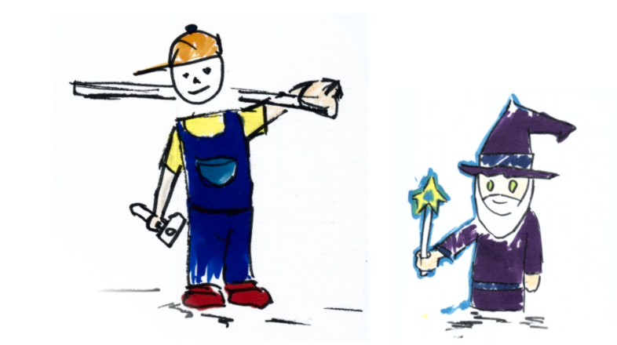

If I got a single cent every time someone in my environment says or writes "agent" or "agentic", I'd be a surefire millionaire. Usually, AI alchemy circles around debating the latest advances of big tech. Yet, it's automation approaches that existed long before LLMs that may have the best shot of turning tokens into gold. 

To **demonstrate** how devOps wizardry can leverage a modestly priced, standard AI offering, I built an app, used a terminal multiplexer, a CLI tool, skills and a Claude subscription to run three agents in parallel to get a thorough review of my project. You can get the full fish script example here:  [h4sci-herdr/review-chain.fish](https://codefloe.com/h4sci/h4sci-herdr) — about forty lines of fish once you strip the comments.

By the end of this tutorial, you will have three AI coding agents running a parallel *split-apply-combine* approach — each reviewing a different slice of a real project — stitched their findings into a single prioritized report, while you watched the whole thing come together like a plan originated by Hannibal Smith. About forty lines of AI generated shell script. No framework, no Python glue, no certification course.

## Step 1 — What is a terminal multiplexer, really?

*TL;DR: a multiplexer tiles your terminal and keeps your work alive.*

The trick behind it is a tool category many have never heard of (*terminal multiplexers*) and a newer entrant in that category that treats AI coding agents the way old-school multiplexers treated shells. Let's build it up from the beginning.

Imagine your terminal window as a desktop. In the old days, one terminal window did exactly one thing: running a program, or editing a file. If you wanted to also tail a log while that program ran, you opened a second window. If your laptop went to sleep, both windows died — and often the program with them.

A **terminal multiplexer** fixes two of those pains at once. It splits one window into many *panes*, each with its own shell, so you can watch three or four things at the same time without juggling tabs. And it keeps those sessions alive on the server even after you disconnect, so you can close the laptop lid and pick up tomorrow where you left off. The mother of all multiplexers is [tmux](https://github.com/tmux/tmux). Its grandparent, [GNU screen](https://www.gnu.org/software/screen/), is still around, too.
Just in case you're feeling historian vibes.


## Step 2 — Herdr: a multiplexer that also speaks "agent"

[Herdr](https://herdr.dev/) is such a terminal multiplexer. All the usual stuff — panes, tabs, workspaces, keybindings — is there, and for the standard mechanics the [herdr docs](https://herdr.dev/docs/) are the right place to start.

What makes herdr different is that it treats *coding agents* (Claude Code, opencode, and friends) as first-class citizens. Where tmux sees "a shell with some stuff happening in it," herdr sees "an agent named `rust-reviewer`, currently working, in a specific state Herdr can report on in JSON." That one difference turns out to **matter a lot when you want to script them**.

## Step 3 — Start simple: one agent started through the CLI

> Note that I use fish shell which leads to me using a shell dialect that does not translate 1:1 to other shells like zsh or standard bash. But be assured: your AI companion has a perfect translation.

Before three agents, let's run one (but already start via script). Obviously there is not much use in starting single agents through a script – this is just to illustrate the herdr CLI. From inside any herdr pane:

```fish
# split the current pane to the right, keep focus on the left
set -l reviewer_pane (herdr pane split --current --direction right \
    --cwd $PWD --no-focus | jq -r '.result.pane.pane_id')

# start a Claude agent in that new pane, name it 'reviewer'
herdr agent start reviewer --kind claude --pane $reviewer_pane \
    -- --permission-mode acceptEdits

# give it a prompt and wait until it reports done
herdr agent prompt reviewer \
    "Explain the architecture of this repo in 10 bullets." \
    --wait --timeout 300000
```

Three commands. One agent, in a visible side pane, doing work you can watch. If this were a thesis task, you'd already be done: an agent summarising a chapter in one pane while you edit the next in the other.

## Step 4 — Three agents, in parallel

Now the useful version. I wanted a thorough review of [jellytrack](https://jellytrack.alpine-jellyfish.ch/), my opensource time-tracker. Written in Rust/Tauri, Svelte 5, sqlite backend, hosted on the ultra-progressive git platform [codefloe](https://codefloe.com/alpine-jellyfish/jellytrack). Three concerns, three specialists:

- a **Rust reviewer** for the `src-tauri/` backend
- a **SQL / capabilities reviewer** for the data layer and Tauri permissions
- a **Svelte reviewer** for the frontend, especially the 946-line `Entries.svelte`

So the idea was instead of one agent slogging through everything sequentially, open three panes side-by-side:

```
+----------+-------------+
|          |   rust      |
|   you    +-------------+
|          |   sql       |
|          +-------------+
|          |   svelte    |
+----------+-------------+
```

In fish, that is three nested splits, each targeting the previous pane:

```fish
set -l rust_pane   (herdr pane split --current         --direction right \
    --cwd $repo --no-focus | jq -r '.result.pane.pane_id')
set -l sql_pane    (herdr pane split --pane $rust_pane --direction down  \
    --cwd $repo --no-focus | jq -r '.result.pane.pane_id')
set -l svelte_pane (herdr pane split --pane $sql_pane  --direction down  \
    --cwd $repo --no-focus | jq -r '.result.pane.pane_id')

herdr agent start rust-reviewer   --kind claude --pane $rust_pane   -- --permission-mode acceptEdits
herdr agent start sql-reviewer    --kind claude --pane $sql_pane    -- --permission-mode acceptEdits
herdr agent start svelte-reviewer --kind claude --pane $svelte_pane -- --permission-mode acceptEdits
```

Then the fan-out: three prompts, backgrounded with `&`, joined by a plain `wait`. Each reviewer writes its findings to its own markdown file.

```fish
herdr agent prompt rust-reviewer   "You are reviewing src-tauri/. ..."  --wait --timeout 600000 &
herdr agent prompt sql-reviewer    "You are reviewing db.ts and ..."     --wait --timeout 600000 &
herdr agent prompt svelte-reviewer "You are reviewing src/lib/*.svelte …" --wait --timeout 600000 &
wait
```

Three Claude instances, three parts of the codebase, running in parallel. You can look over any shoulder in real time. 

## A Quick Warning: Anthropic Subscription vs. API credits

With herdr you can use a plethora of harnesses like *claude code cli*, *opencode*, *pi.dev* and many more. When you have a moderately priced Claude Pro subscription capping your costs at ~$20 USD, you cannot use third party harnesses, you have to stick to Claude's own cli. You can still use herdr, so it's not a big deal. It's more about pointing you to the fact that if you love third party CLIs to the degree that you end up getting an API subscription from Anthropic, you're paying per use on top of the lump sum $20. Costs won't be extraordinary in most cases even that way, but be advised to set a spending limit then because an army of agents might go on a spree. 

That being said third party harnesses are super useful in hybrid models, like do certain stuff with Claude, do other stuff with opencode and a local llama.cpp model or your company's on-premise GPU if you got some. 

## Step 5 — Fan in: let a fourth agent write the report

Three markdown files are not a report. The last step opens a new pane, starts a `synthesizer` agent, and asks it to read the three reviewer files and produce one prioritized `report.md`.

```fish
set -l synth_pane (herdr pane split --current --direction down --cwd (pwd) --no-focus \
    | jq -r '.result.pane.pane_id')
herdr agent start synthesizer --kind claude --pane $synth_pane -- --permission-mode acceptEdits
herdr agent prompt synthesizer \
    "Read $out/rust.md $out/sql.md $out/svelte.md, dedupe, prioritize, write $out/report.md." \
    --wait --timeout 600000
wait_unblocked synthesizer
```

The full chain lives at [h4sci-herdr/review-chain.fish](https://codefloe.com/h4sci/h4sci-herdr) — about forty lines of fish once you strip the comments.

On this particular run against jellytrack it flagged no **critical**, but six **high**-severity findings clustered right at the Rust ↔ JavaScript boundary — a `create_new_db` command that would cheerfully `remove_file()` on any path the frontend passed it, a `sqlite://` connection URL built by `format!`ing a raw path (so a space, `#`, `?`, or `%` silently opens the wrong file or none), a latent SQL identifier-injection in `updateEntry`, and a double-load race in two Svelte components that silently reverts a user's unsaved note. None of those were on my own to-do list.

> **Bottom line:** the report is highly useful and a perfect input to work with for humans and machines. Plus, it's considerably more involvement and fun, compared to the dull approve-every-turn of a ping-pong-game process.

## Carpentry Meets Wizardry



My old drawing made before AI was mainstream asked whether field-specific experts in research necessarily needed to become grand wizards of software engineering. The corresponding article argued that replacing researcher spaghetti code with solid carpentry was rather the goal than mastering the artform of software engineering.

With AI this is more true than ever (albeit for different reasons). It helps to know what you're doing [to make your product useful for the carpenter, to stay involved in stack choices and to assess weightings and severities in reports](https://h4sci.github.io/blog/ai-age-programming/) like the one we created in this tutorial. Imagine the wizard working for the carpenter now.  

## The Empire Strikes Back Moment (What to Take Home)

Admittedly I am old. So, yes I am really referring to a movie first released on May 21 in 1980. 
To a moment when Luke Skywalker whose name lives on to this day and time, was forced by his mentor Yoda to go into a dark, fearful cave to face and fight himself. I observe many researchers and other mind puzzle lovers are going through the same challenge just without the iconic light saber.

There is a lot of noise and macro debates around AI and we sometimes use these as excuses not to use AI full throttle. Note, I am not saying we should. What I mean though is we as data workers, researchers and engineers should at least face the challenge of seeing AI operate full throttle on our turf. Just like Luke in that cave, face everything  he brought with him in the context of that sometimes fearful cave that AI is. 

Creating software, analysing data and all related fields will never be the same. No matter whether we tried it out the new way or not. The next step is to see whether we find a role within that new approach that is worthwhile and fun to us.


## In This Post

- [herdr](https://herdr.dev/)
- [herdr demo (review-chain.fish)](https://codefloe.com/h4sci/h4sci-herdr)
- [jellytrack](https://jellytrack.alpine-jellyfish.ch/)
- [Rust](https://www.rust-lang.org/)
- [Tauri](https://tauri.app/)
- [fish shell](https://fishshell.com/)
- [codefloe](https://codefloe.com/)
- [SQLite](https://www.sqlite.org/)
